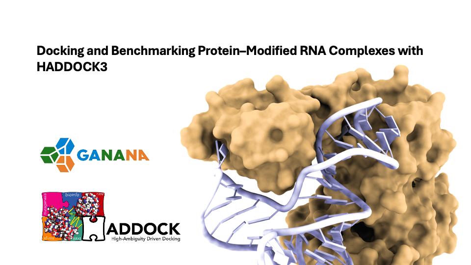

<p align="center">
  
</p>

# Protein–Modified-RNA Docking Benchmark

## Introduction

<p align="justify">
Protein–RNA interactions are essential to many biological processes, and molecular docking offers a computational route to modelling these complexes. Docking RNA that carries chemically modified nucleotides remains challenging, because standard nucleic-acid force fields lack the parameters needed to represent the modifications explicitly. Modelling a modified nucleotide accurately requires force-field parametrization: atomic connectivity, bonded terms (bonds, angles and dihedrals), van der Waals parameters, and partial atomic charges consistent with the rest of the nucleic-acid force field. Without these parameters, modified residues usually have to be stripped or replaced by their canonical counterparts before docking, losing chemical features that can be important for protein–RNA recognition.
</p>

<p align="justify">
As part of the <a href="https://github.com/GANANA-EU-INDIA">GANANA EU–India</a> project, we integrated force-field parameters for modified RNA nucleotides in HADDOCK3 and curated this protein–modified-RNA docking benchmarks that  provides a curated set of experimentally determined protein–RNA complexes in which the modified residue is kept explicitly. It is meant for developing, validating and comparing docking protocols that handle modified RNA.
</p>

<p align="justify">
<a href="https://www.bonvinlab.org/education/HADDOCK3/">HADDOCK3</a> (High Ambiguity Driven protein–protein DOCKing) is the modular, next-generation version of the HADDOCK integrative modelling software from the <a href="https://www.bonvinlab.org/">Bonvin lab</a>. It integrates various types of information, including experimental data (biochemical and biophysical), bioinformatic predictions and prior knowledge, to guide the docking process.
</p>

## Docking benchmark

The benchmark comprises a total of **18 experimentally determined protein–RNA complexes**, each with an RNA carrying one of five chemically modified nucleotides.

| Code | Modification | Common name | Cases |
|---|---|---|---:|
| `6MZ` | N6-methyladenosine | m6A | 9 |
| `1MA` | 1-methyladenosine | m1A | 1 |
| `5MC` | 5-methylcytidine | m5C | 3 |
| `A2M` | 2'-O-methyladenosine | Am | 4 |
| `PSU` | Pseudouridine | Ψ | 1 |
| | | **Total** | **18** |

For the per-case details (chains, residue counts, RNA length, target residue, AIRs) and case-specific notes, see [`docs/README.md`](docs/README.md). A summary of all cases is in [`docs/master_summary.tsv`](docs/master_summary.tsv), and the full metadata for each case, including the RNA sequence, is in its `info.tsv`.

## Current version

**v1.0**

### Version history

| Date | Version | Changes |
|---|---|---|
| 06-10-2026 | 1.0 | First release: 18 bound cases covering five modifications. |

## Data organization

The benchmark has one directory per complex, named by the PDB ID of the reference structure:

```text
.
├── README.md
├── LICENSE
├── docs/
│   ├── README.md                 table of all benchmark cases
│   ├── workflow.md               how each case was prepared
│   └── master_summary.tsv        one row per complex (summary)
├── scripts/
│   └── README.md                 how to run a case
├── 2MTV/
├── 4RCJ/
├── ...
└── 9QRP/
```

Each directory `X/` contains the following files:

| File | Description |
|---|---|
| `X.cif` | Unmodified RCSB PDB entry of the complex (mmCIF), kept as the reference. |
| `X_p_b.pdb` | Processed **bound protein** (receptor), extracted from the complex. Multi-chain receptors are kept in this one file so that HADDOCK treats them as a single body. |
| `X_r_b.pdb` | Processed **bound RNA** (ligand), extracted from the complex, with the modified nucleotide kept. |
| `X_p_b_ens.pdb`, `X_r_b_ens.pdb` | NMR cases only (2MTV, 8COO): all 20 deposited models of the bound protein and RNA as multi-model ensembles. They are prepared exactly like `X_p_b.pdb`/`X_r_b.pdb`, and model 1 is identical to those files. |
| `X_target.pdb` | Bound complex rebuilt from `X_p_b.pdb` + `X_r_b.pdb`. This is the reference for `caprieval`. |
| `X_b_ambig.tbl` | Ambiguous interaction restraints (AIRs) for bound docking: the true interface, any atom within 5.0 Å. Chain IDs are used as segids. |
| `X_b_dock.cfg` | HADDOCK3 configuration for bound docking of this case. |
| `contacts.dat` | Intermolecular residue–residue contacts within 5.0 Å in the bound complex. Columns: `prot_chain prot_resid prot_res rna_chain rna_resid rna_res min_dist_A`. |
| `info.tsv` | Full metadata for this case, including the RNA sequence, target residue, AIR counts and protein atom count. |

In file names, `p` = protein, `r` = RNA, `b` = bound.

The protein and RNA chain identifiers never overlap within a case. The modified nucleotides use the residue names of the forcefield templates (`6MZ`, `1MA`, `5MC`, `A2M`, `PSU`), and standard nucleotides use the one-letter RNA codes (`A`, `C`, `G`, `U`).

## Workflow

[`docs/workflow.md`](docs/workflow.md) describes how the cases were selected and prepared. Each case is an experimentally determined protein–RNA complex in which a supported modified nucleotide lies at the protein–RNA interface. The document also covers cleaning, receptor selection, restraint definition and validation.

## Running a case

[`scripts/README.md`](scripts/README.md) explains how to run a case with HADDOCK3: the command, the docking pipeline and the settings to adjust for your machine.

## Citation

A reference for this benchmark will be added here on publication. Until then, if you use the benchmark, please cite HADDOCK3:

**Research article**

M. Giulini, V. Reys, J.M.C. Teixeira, B. Jiménez-García, R.V. Honorato, A. Kravchenko, X. Xu, R. Versini, A. Engel, S. Verhoeven, A.M.J.J. Bonvin. HADDOCK3: A modular and versatile platform for integrative modelling of biomolecular complexes. *Journal of Chemical Information and Modeling* (2025). doi: [10.1021/acs.jcim.5c00969](https://doi.org/10.1021/acs.jcim.5c00969)


## License

This benchmark is released under the [Apache License 2.0](LICENSE).
